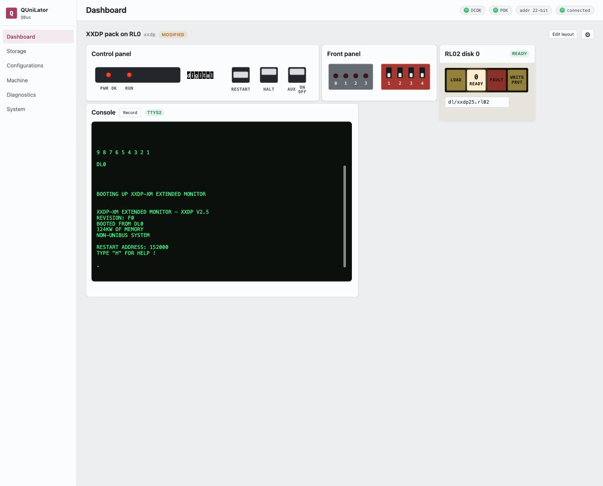

The machine as it is now, built from **widgets** you place yourself. The heading
names the configuration that is loaded — its title, its short name, and a
**MODIFIED** badge when the live machine has drifted from what was saved.

## Control panel

The lamps and switches of a PDP-11/03 bezel, and the only place the machine is
started and stopped.

| | |
|---|---|
| **PWR OK** | the logical power flag. Lit means the machine is switched on. |
| **RUN** | the CPU is executing — powered, with HALT released. |
| **RESTART** | momentary. Runs the processor again from its power-up vector. |
| **HALT** | two-position, like the front-panel toggle. Down stops the CPU; up releases it. |
| **AUX ON/OFF** | two-position. **This is the power switch** — it drives the logical DC power flag, and it is what brings up a machine that came up dark. |

> [!TIP]
> **RESTART after a halt, not a power cycle**
>
> A power cycle does not release HALT, so a halted CPU comes back in ODT rather
> than running. Release HALT and press **RESTART**.

## Front panel

The four activity LEDs and four DIP switches on the card itself.

The switches are read **once, when the service starts**, to choose which
configuration to load — so changing them here shows you their position but does
not reselect a machine. That takes a restart of the service. See
[Power-on DIP](configurations.md#power-on-dip).

## Console

The machine's serial console as a terminal in the page. The badge says which line
it is showing — **TTYS2** for the real console of a CPU that has its own serial
line, or the emulated DL11 channel otherwise.

**Record** captures the session to a file on the board: what the machine printed
*and* what was typed at it, whoever typed it. The recordings are listed on
[System](system.md#console-recordings).

**Log** keeps what the console shows in this browser, from the moment it is
pressed, and saves it as a `console-<date>-<time>.log` file when it is pressed
again. It goes on while you visit other screens.

Selecting text in the console copies it to the clipboard; **Ctrl+Shift+C**
copies the selection again. Ctrl+C itself goes to the machine.

> [!CAUTION]
> **The external console has no receive buffer**
>
> On the external console, typing at human speed is fine. Pasting is not: a
> burst of bytes overruns the processor's single receive register and the guest
> sees only a few of them — `ra(0,0,0)unix` arrives as `r,)x`. Type it, send it
> with **Send file** and its echo check, or drive it from a script that paces
> each character on its echo.
>
> The emulated `DL11` channels hand the guest each character when it has read
> the one before, so a paste reaches them whole.

### Sending and receiving files

**Send file** puts a file from your computer onto the guest through the
console, in one of three ways. Pick the file, or drop it on the console, choose
how it goes, and press **Send** — the dialog remembers the last choice, so a
dropped file usually needs only Return. **Receive file** fetches files from
the guest by XMODEM or Kermit, and the browser saves them where it saves any
download — on the computer running the browser, not on the board. A bar shows the
progress, and **Cancel** stops the transfer. The keyboard waits while a file is
going over.

While a transfer runs, the line is the transfer's. What the guest sends goes to
the page running it and nowhere else: other open consoles show a note that a
transfer is using the console, and the transfer's packets stay out of the
history a console is shown when it connects and out of a recording. On the VAX
console, Ctrl-P in the data is the program's, as with the console's key switch
at LOCAL DISABLE, and does not halt the machine.

**Typed text** sends the file as if it were typed at the console, into
whatever reads the terminal there: `cat > file` on a Unix, `CREATE file` on
VMS, an editor's insert mode. Line ends go as Return. The checks and delays
can be used alone or together:

| | |
|---|---|
| **Echo** | Each character waits for the guest's echo, up to the time given. An echo in upper case for lower case, a tab echoed as spaces, and a line end the guest puts into a long line all count. A character the guest takes without an echo is counted, and the text goes on after the timeout. |
| **Receive buffer** | With the echo check, how many characters go ahead of the echo awaited, for a guest whose line holds characters while it works on one. 1 by default; 0 sends each character only once the one before has echoed. A line end waits for every echo. |
| **Prompt** | After each line, wait until the guest prints this text again, for a program that reads a line at a time and prints a prompt when it wants the next. Empty to leave it off. |
| **Delay** | A pause after each character and after each line. |

At the end the dialog says how many characters went on without their echo and
how many lines without the prompt; both are 0 for a clean transfer.

> [!NOTE]
> **The guest's terminal settings still apply**
>
> The text arrives the way typing would. VMS on a terminal set to
> `/NOLOWERCASE` takes `}` and the characters after it without echoing or
> keeping them, and a Unix in `stty lcase` changes the case of what it keeps.
> Set the terminal for plain text before sending.

**XMODEM** sends the file in 128-byte blocks with a checksum or a CRC, as the
receiver asks; with **1K blocks** set, a receiver that asks for CRC gets
1024-byte blocks. Start the receiver on the guest, such as `rx file`, before
or within a minute of **Send**. XMODEM carries eight bits per byte: on a
console line that carries seven — the VAX console unless `console_8bit` is
set, a DL11 in a 7-bit mode, an external console set to 7-bit — the dialog
says so, and Kermit is the way to send.

**Kermit** sends the file under the name given, as text with the guest's own
line ends or as binary. Start Kermit on the guest and give it `RECEIVE`, or
put it in server mode, before or within a minute of **Send**. The packets are
printable characters, and a byte with its eighth bit set goes as a prefixed
pair, so a binary file arrives whole over a seven-bit line.

Typed text and Kermit keep to XON/XOFF on an emulated console line: while the
guest has sent XOFF, the board holds the rest back until XON, as a terminal
does. A guest that reads its line through a small buffer needs it — RT-11's
`XL` handler holds 64 characters, less than a Kermit packet. XMODEM goes
without, since its blocks carry those bytes as data.

To receive, press **Receive file**, choose the protocol, start the sender on
the guest, and press **Receive** — in either order, within a minute.

| | |
|---|---|
| **XMODEM** | Start the guest's sender, such as `sx file`. XMODEM carries no file name, so the file is saved under the name given; **Padding** takes the ^Z characters that fill out the last block off the end, which suits a text file. Eight bits per byte, as for sending. |
| **Kermit** | Have the guest's Kermit `SEND` one file or several; each is saved under the name the guest sends. **Line ends** turns CR LF into LF, for text files kept on a Unix-like computer. |

## Device widgets

One widget per device, each carrying the controls the real unit had. A device
gets the widget its model calls for, and otherwise the one its class shares:

| | |
|---|---|
| **RL01/RL02** | the drive's own panel — LOAD, READY, FAULT, WRITE PROT, and the unit number |
| **RA81 and other MSCP volumes** | RUN/STOP, FAULT, READY, WRITE PROT, and the A/B port buttons |
| **RX01/RX02** | floppy drives |
| **Tapes** | load, unload and the write ring |
| **Memory** | the range claimed, out of the board's own DDR |
| **MRV11-D** | the bootstrap ROM and which image it carries |
| **DZV11, DHV11** | the serial mux lines, and where each is reachable |
| **DELQA, DEUNA** | LINK and ACT lamps, the host interface and the station address |
| **VCB01** | the graphics framebuffer |
| **Processors** | an emulated CPU's own state |

The field under a drive is the image it holds — **swapping a pack is editing
that field**.

## Laying it out

**Edit layout** moves and resizes the widgets, with **Save layout** and
**Revert**. The arrangement is stored *with the configuration*, so each machine
remembers how you like to look at it, and an exported configuration carries its
layout to whoever you send it to.

The cog beside it opens the [configuration](configurations.md) this dashboard is
showing.
